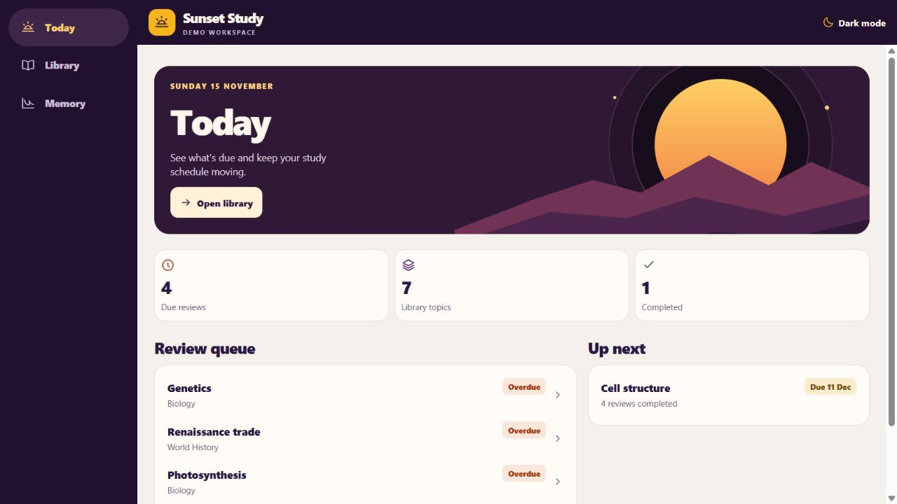
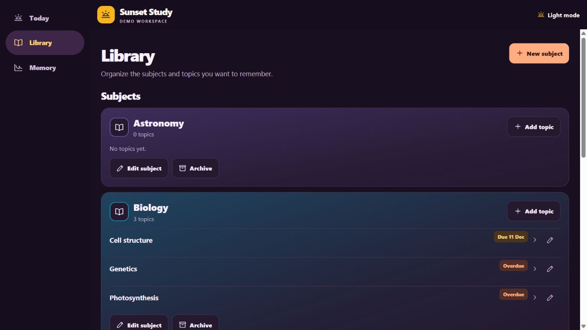
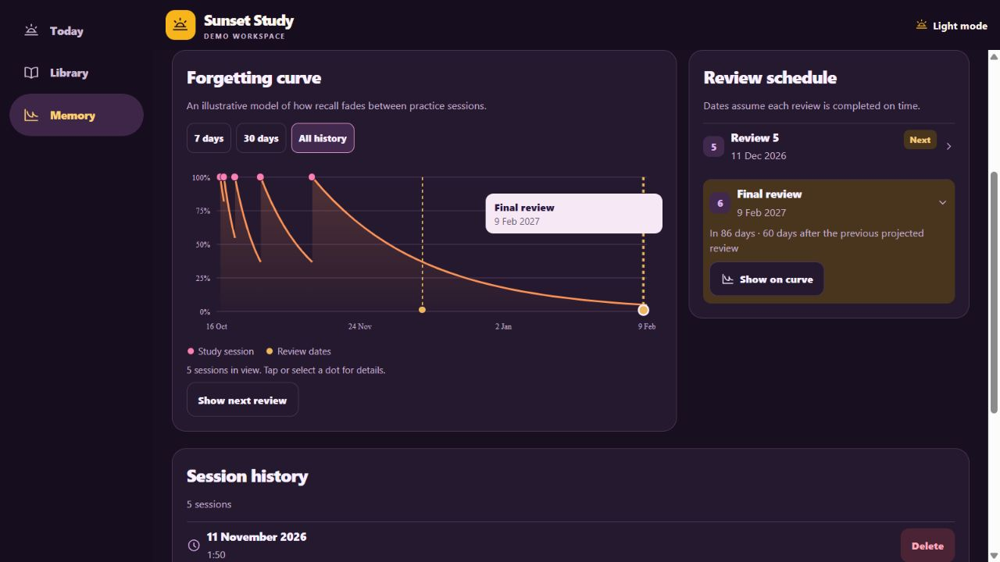

# LocalStudyMobile

LocalStudyMobile is an offline study planner for Android and iOS, with a web preview for local development. It uses Expo, React Native, JavaScript, and SQLite.

## What you can do

- **Today** shows due and overdue reviews, upcoming reviews, and study progress.
- **Library** organizes subjects and topics. Add or edit a subject to choose a color swatch or enter a hex code. The saved color gives the subject card a gradient. Archive and restore subjects from the same screen.
- **Memory** shows the review schedule, forgetting curve, and session history. Filter the curve to 7 days, 30 days, or all history. Hover, focus, or tap a session marker to see its details. Expand a review date to highlight it on the curve or log it when it is due.
- **Appearance** switches between light and dark mode from the header and remembers your choice.

The first study session schedules a review for the next day. The intervals are 1, 3, 7, 14, 30, and 60 days. Early practice stays in the session history and keeps the existing due date. Deleting a session recalculates the schedule. The forgetting curve illustrates estimated recall over time.

## Screenshots

**Today in light mode**



**Library in dark mode**



**Memory with a selected review**



## Run locally

Use Node.js 22.13 or later on the Node 22 line, or Node.js 24.3 or later on the Node 24 line. Install dependencies with npm.

```sh
npm ci
npm run web
```

Open the localhost URL printed by Expo. For Android, run `npm run android` with an emulator or connected device. For the iOS Simulator, run `npm run ios` on macOS with Xcode installed. `npm start` opens the Expo development menu.

### Run with demo data

Set `EXPO_PUBLIC_STUDY_DEMO=1` when starting Expo to load sample subjects, sessions, and review dates into a separate local SQLite database.

On macOS or Linux, run:

```sh
EXPO_PUBLIC_STUDY_DEMO=1 npm run web -- --port 8082
```

In PowerShell, run:

```powershell
$env:EXPO_PUBLIC_STUDY_DEMO = '1'
npm run web -- --port 8082
```

Then open `http://localhost:8082`. Browse **Biology → Cell structure** to try the forgetting curve with several logged sessions. In PowerShell, run `Remove-Item Env:EXPO_PUBLIC_STUDY_DEMO` before starting the regular workspace again from the same shell.
